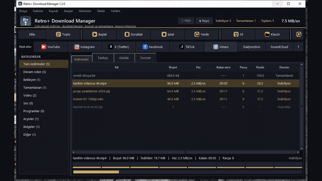

<p align="center">
  
</p>

<p align="center">
  <a href="#language">🌐 English</a> ·
  <a href="README.tr.md">🇹🇷 Türkçe</a> ·
  <a href="README.de.md">Deutsch</a> ·
  <a href="README.fr.md">Français</a> ·
  <a href="README.es.md">Español</a>
</p>

<p align="center">
  
  
  
  
  
</p>

# Retro+ Download Manager — Multi-Segment Download Manager (Pause/Resume · Queue · Scheduler · Torrent · yt-dlp)

> **TR:** Çok parçalı indirme yöneticisi — duraklat/devam, kuyruk, zamanlama, web sayfası &
> oynatma listesi çözümleme ve tarayıcı köprüsü. Türkçe Tkinter arayüzü; kütüphane olarak da
> kullanılabilir. Detaylar için [README.tr.md](README.tr.md).

**Retro+ Download Manager** is a standalone Python download manager with multi-segment (parallel)
downloading, pause/resume at any point, queue and scheduling, automatic file categorization,
clipboard & webpage link grabbing, a local browser bridge, and a polished dark-theme Tkinter UI.

The module works both as a **desktop application** and as a **Python library** — you can plug the
`DownloadManager` class into your own program without the GUI.

> The repository name is `Retro-Download-Manager` (GitHub does not accept spaces or `+` in repo
> names); the product name is **Retro+ Download Manager**.

---

## Features

| Feature | Status | Notes |
| --- | :---: | --- |
| Multi-segment downloads (parallel) | ✅ | 8 segments by default, up to 32 |
| Pause / resume at any point | ✅ | HTTP 206 `Range` replay from the progress file |
| Unknown size / no-`Range` servers | ✅ | Single-segment fallback + gradual staging |
| Conflicting/missing `Content-Length` | ✅ | `HEAD` + `Range` verification; segments slim down on mismatch |
| Scheduled / recurring downloads | ✅ | Queue + hourly/daily planner |
| Pause threshold and speed limit | ✅ | KB/s cap, optional quota |
| Category rules (video/music/archive…) | ✅ | Extension + keyword matching into folders |
| Browser link grabber | ✅ | Clipboard monitoring + local HTTP bridge (`/links`, `/add`) |
| Webpage / playlist link parsing | ✅ | `og:video`/`<source>` scanning + yt-dlp (a 56-video list queued in one click) |
| Quick site buttons | ✅ | YouTube, Instagram, X (Twitter), Facebook, TikTok, Vimeo — one-click add |
| Video downloads (audio+video merge) | ✅ | yt-dlp + ffmpeg automatic muxing for YouTube etc. |
| Site password / cookie support | ✅ | Via `headers`/`cookies` fields |
| FTP / FTPS | ✅ | Segmented FTP download with pause/resume |
| Local self-update (no external link) | ✅ | `version.json` + zip + SHA-256; folder/UNC/HTTP source, silent install + restart |
| WhatsApp PDF capture | ✅ | Linked-device (QR) listener + whitelist; only chosen chats deliver PDFs |
| Torrent (magnet / `.torrent`) | ✅ | aria2 engine, dedicated tab, `magnet:` Windows registration (`tools/magnet_bagla.ps1`) |
| MMS/RTSP, FTPS with custom tunnel | ❌ | Not supported |

## Screenshots


More views: [Add Download](docs/screenshots/gui-add-link.png) ·
[Site Grabber](docs/screenshots/gui-grabber.png) ·
[Settings](docs/screenshots/gui-settings.png)

## Design & Theme

The UI follows a luxury desktop design language:

- **Anthracite dark theme** (`#0F1115`) with a single **champagne-gold accent** (`#C9A962`)
- **3 themes**: Dark (anthracite), Light (warm white), Midnight — selectable in Settings,
  `Ctrl+T` cycles, choice persists
- **Dark title bar** (DWM immersive dark mode; automatic per theme)
- **Custom menu bar** that matches the theme (no white residue in dark mode)
- **Custom icon set** — action icons in monochrome champagne-gold chip style (`tools/recolor_icons.py`)
- **1px borders**, subtle layered surfaces instead of shadows
- **Inter-style typographic hierarchy** + generous spacing tokens (`theme.py`)
- **150–300 ms micro-animations** — dialog fade-in, hover states

## Installation

```bash
git clone https://github.com/RetroNyym/Retro-Download-Manager.git
cd Retro-Download-Manager
python -m pip install -r requirements.txt
```

The only runtime dependency is `requests`; if `tkinterdnd2` is installed, drag & drop is enabled.

Video/playlist links (YouTube, Vimeo, …) optionally require `yt-dlp` and `ffmpeg`; if neither is
installed the app continues with normal downloads:

```bash
python -m pip install yt-dlp
winget install Gyan.FFmpeg        # for audio+video muxing
```

## Running

```bash
python -m download_manager        # GUI (console attached)
baslat_gui.bat                    # Windows shortcut (console-free, pythonw)
baslat_gui.vbs                    # Windows: fully hidden start, no window at all
```

## Using as a library

```python
from download_manager import DownloadManager

mgr = DownloadManager(max_tasks=4)          # settings persist to the data folder
mgr.add(["https://example.com/file.zip", "https://example.com/episode-01.mkv"],
        segments=16,                        # segment count (1..32)
        speed_limit=2048)                   # KB/s, None = unlimited
mgr.start()                                 # queue starts working
```

State, progress and results are readable via `mgr.tasks`; when the app restarts, half-finished
downloads resume from `download_manager/data/state.json`.

## Web page & video links

Links pasted into the address bar are scanned and the right engine is picked automatically:

| Input | Behavior |
| --- | --- |
| Direct file (`.zip`, `.mp4`, …) | multi-segment HTTP/FTP download |
| `.html`/`.htm` link | page saved as file |
| Webpage (extension-less, PHP, …) | `og:video`/`<source>`/JSON-LD resolve the media address |
| Page without media | clean error message, no file created |
| Playlist / video page (YouTube etc.) | yt-dlp parses the list, all videos queued |
| Separate audio+video stream (DASH) | yt-dlp downloads, ffmpeg merges into one file |
| Site link (YouTube/Instagram/X/Facebook/TikTok/Vimeo) | quick site button → paste → automatic site parser |

Single-segment downloads can also be added in bulk via the **Site Grabber** (all media links on
the same page).

## Browser bridge

A local bridge server moves typed links into the UI
(`http://127.0.0.1:8877`, bound to your machine only):

| Endpoint | What it does |
| --- | --- |
| `GET /add?url=...` | adds a link to the queue |
| `GET /status` | queue summary |
| `GET /links?url=...` | scans the given page and returns media links as JSON (`depth` and `extensions` parameters supported; same as `/grab`) |
| `GET /torrent?url=magnet:...` | adds a magnet/.torrent, returns `gid` |
| `GET /torrents` | list of added torrents |

Bookmarklet you can add to your browser:

```javascript
javascript:(function(){fetch('http://127.0.0.1:8877/add?url='+encodeURIComponent(location.href))})()
```

## Torrent (BitTorrent) support

`magnet:` links and `.torrent` files are downloaded by Retro+'s own engine
(a dedicated **Torrent** tab in the UI; part of the app, not a separate process):

- **Engine:** embedded [aria2](https://aria2.github.io/) (`tools/aria2/aria2c.exe`,
  arrives under `tools/` during download; can be provided externally via `RETRO_ARIA2`).
  Starts lazily: opened when the first torrent is added, stopped when the program exits.
- **Persistence:** added URIs are written to `data/torrents.json`; on a fresh start
  unfinished torrents are re-added automatically.
- **Windows `magnet:` binding** (no admin needed, HKCU only):

  ```powershell
  powershell -ExecutionPolicy Bypass -File tools\magnet_bagla.ps1
  powershell -ExecutionPolicy Bypass -File tools\magnet_bagla.ps1 -Kaldir   # revert
  ```

  On a source install it binds to `pythonw -m download_manager --magnet "%1"`;
  with the portable exe use `magnet_bagla.ps1 -Exe "C:\Path\RetroDownloadManager.exe"`.
- **Limits (v1):** downloads via web seeds (DHT/PEX); tracker-less/private torrents may
  not speed up. The torrent folder defaults to `Download folder\Torrents`
  (change in Settings → Torrent).
- Build note: the exe packaging includes it with `--add-data "tools;tools"`
  (ready-made command at the top of `baslat_exe.py`).
- **Verification:** `tests/test_torrent.py` 23/23; a live test against a real
  Ubuntu 26.04.1 .torrent **14/14** (peer connect, data flow, pause/resume/remove,
  state+PID cleanup); portable exe smoke with `RETRO_SMOKE=1` → exit 0
  (`dist\data\torrents.json` written, aria2 cleaned on shutdown).

## Automatic update (local source)

Version distribution works without depending on GitHub: an update folder (local disk,
UNC share or HTTP) contains `version.json` + a zip package.

```bash
python tools\\pack_update.py --out \\\\server\\share\\retro
```

At launch (and every 6 hours in the background) the source is checked; if a new version
exists it downloads — waiting for active downloads to finish — verifies SHA-256, installs
and restarts itself; the user never clicks a link. Source: Settings → Updater. User data
(`data/`), `.git` and the WhatsApp session are preserved during updates; on error it is
restored from the backup.

## WhatsApp PDF capture

```bash
cd whatsapp_listener
npm install        # once (Node.js 18+)
```

Settings → WhatsApp: watch/target folder + **whitelist** (only the chats you choose).
**Start listener** → scan `qr.png` from your phone → **Load chats** to pick the allowed
ones. No files are downloaded from chats outside the whitelist (double-checked in the
listener and on the Python side).

## Architecture

| File | Role |
| --- | --- |
| `download_manager/engine.py` | multi-segment download engine (HTTP/FTP, pause/resume, retry, mirror URLs) |
| `download_manager/manager.py` | queue, scheduler, categories, grabber, bridge, history, settings |
| `download_manager/gui.py` | Tkinter UI (category panel, icon toolbar, segment visibility) |
| `download_manager/extractor.py` | webpage media parsing, yt-dlp/ffmpeg bridge, playlist expansion |
| `download_manager/util.py` | category detection, formatting, file helpers |
| `download_manager/notify.py` | completion/error sound notification |
| `download_manager/updater.py` | local update channel (manifest, SHA-256, staging, rollback, restart) |
| `download_manager/whatsapp.py` | WhatsApp PDF watcher (metadata + whitelist + move to target) |
| `download_manager/torrent.py` | aria2 engine (JSON-RPC, port scan, `torrents.json` persistence) |
| `whatsapp_listener/` | Node/Baileys linked-device listener (QR, chat list, PDF download) |
| `tools/pack_update.py` | local update package builder (`dist/` → zip + `version.json`) |
| `tests/` | 199 checks (engine, FTP, bridge, torrent, restart, GUI, page/media, update, WhatsApp) |

## Tests

| File | Scope | Checks |
| --- | --- | ---: |
| `tests/test_download_manager.py` | multi-segment, no-`Range`, unknown size, pause/resume, cancel, queue, grabber, persistence | 37 |
| `tests/test_restart_resume.py` | pause on close → resume after restart + a real internet download | 8 |
| `tests/test_ftp.py` | FTP segments/pause/cancel (`pip install pyftpdlib`) | 10 |
| `tests/test_bridge.py` | bridge endpoints (`/add`, `/links`, `/status`) | 7 |
| `tests/test_gui.py` | dialogs, quick site buttons, torrent tab and the UI (needs a display/`tkinter`) | 34 |
| `tests/test_page_media.py` | webpage parsing, clean error without media, `.html` behavior, site names | 22 |
| `tests/test_torrent.py` | aria2 startup, HTTP download, magnet add/pause/remove, bridge `/torrent`, persistence | 23 |
| `tests/test_updater.py` | version comparison, manifest, SHA-256 rejection, zip-slip, rollback, install | 35 |
| `tests/test_whatsapp.py` | whitelist matching, metadata, watcher delivery, closed/empty states | 23 |

```bash
python tests/test_download_manager.py
python tests/test_restart_resume.py
python tests/test_bridge.py
python tests/test_torrent.py      # requires tools/aria2/aria2c.exe
python tests/test_ftp.py          # pip install pyftpdlib
python tests/test_gui.py          # requires a graphical session
python tests/test_page_media.py
python tests/test_updater.py
python tests/test_whatsapp.py
```

Lint: `python -m pyflakes download_manager`.

## Demo video

A short promo clip (`docs/promo/promo.mp4`) is generated for the project page
and social channels — watch it here:

https://github.com/RetroNyym/Retro-Download-Manager/raw/main/docs/promo/promo.mp4

<p align="center">
  
</p>

## Screenshot production

Application screenshots are generated with a single command for portal submissions
(no internet used; a local `Range`-capable server is opened):

```bash
python tools/shots.py
# docs/screenshots/gui-downloads.png, gui-add-link.png, gui-grabber.png, gui-settings.png
```

## Portal submission / distribution package

Ready-made texts and a checklist for submissions to software download portals (global and
Turkish) are in the `docs/submission/` folder; see [SUBMISSION.md](SUBMISSION.md) for an overview.

| File | Contents |
| --- | --- |
| `docs/submission/metinler-tr.md` | Turkish short/long description, metadata fields, screenshots, FAQ |
| `docs/submission/metinler-en.md` | The English counterparts |
| `docs/submission/e-posta-sablonlari.md` | Portal/promo e-mail templates (TR + EN) |
| `docs/submission/KONTROL-LISTESI.md` | Which portals were applied to, status, date |

## Limitations

- Browser integration comes via a **local bridge + clipboard monitoring** instead of an extension.
- If the server does not support `Range`, parallel segments are not used (everything completes serially).
- Video downloads are executed by yt-dlp; instead of pause/resume it uses cancel→restart logic
  (unlike single-segment `Range` downloads).
- `FTP over explicit TLS` (FTPS) is experimental; on some servers it falls back to `NLST` instead of `MLSD`.
- Parallel segments always speed up as much as the server allows; the speed limit is client-side.
- The WhatsApp listener is not the official API; it uses the WhatsApp Web protocol (Baileys) and
  requires a Node.js install and QR pairing.

## License

[MIT](LICENSE) © RetroNyym
