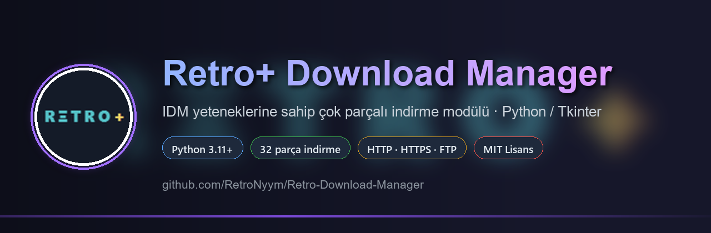
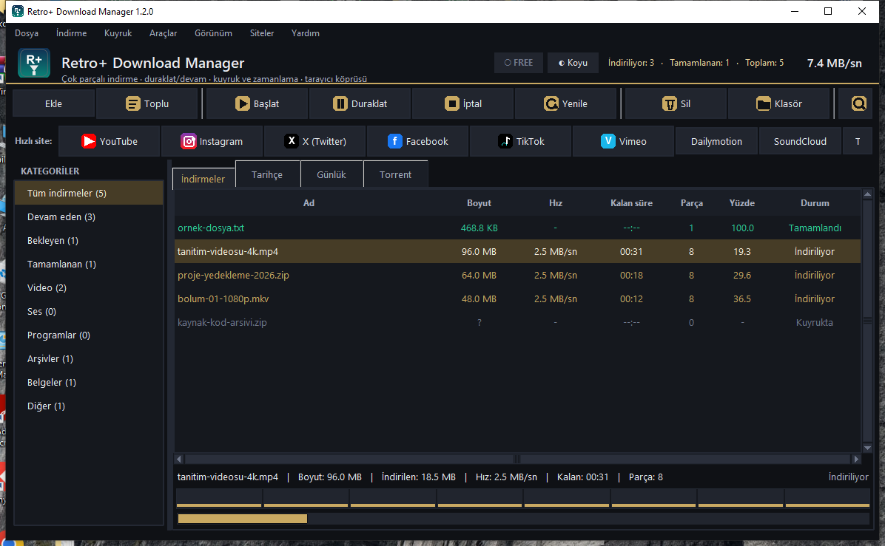

<p align="center">
  
</p>

<p align="center">
  
  
  
  
  
</p>

# Retro+ Download Manager — çok parçalı (segmentli) indirme yöneticisi

> **EN:** Multi-segment download manager with pause/resume, queue, scheduler,
> webpage & playlist parsing and a browser bridge. Turkish Tkinter GUI, usable
> as a library too.

**Retro+ Download Manager**, çok parçalı (segmentli) indirme, duraklat/devam, kuyruk, zamanlama,
otomatik dosya kategorileri, bağlantı grabber'ı, web sayfası/playlist çözümleme, tarayıcı köprüsü
ve Türkçe Tkinter arayüzü sunan bağımsız bir Python indirme yöneticisidir.

Modül hem **masaüstü uygulaması** hem de **Python kütüphanesi** olarak kullanılabilir — GUI olmadan
`DownloadManager` sınıfını doğrudan kendi programınıza bağlayabilirsiniz.

> Depo adı `Retro-Download-Manager` (GitHub boşluk ve `+` karakterini depo adında kabul etmez),
> ürün adı **Retro+ Download Manager**'dır.

---

## Özellikler

| Özellik | Durum | Not |
| --- | :---: | --- |
| Çok parçalı indirme (paralel segment) | ✅ | Varsayılan 8, en fazla 32 parça |
| Duraklat / devam (her noktadan) | ✅ | 206 Range ile ilerleme dosyasına yazılır |
| Bilinmeyen boyutlu / `Range` desteklemeyen sunucu | ✅ | Tek parça + hazır olan kadar parçalı kademelenme |
| Çelişkili/eksik `Content-Length` çözümü | ✅ | `HEAD` + `Range` teyidi, uzunluk uyuşmazlığında parça sadeleştirilir |
| Zamanlanmış / tekrarlayan indirme | ✅ | Kuyruk + saatlik/günlük planlayıcı |
| Duraklatma sırasında bitiş eşiği ve hız sınırı | ✅ | KB/sn sınırı, isteğe bağlı kota |
| Kategori kuralı (video/müzik/arşiv...) | ✅ | Uzantı + anahtar kelime, eşleşene göre klasöre ayırır |
| Tarayıcı bağlantı grabber'ı | ✅ | Pano izleme + yerel HTTP köprüsü (`/links`, `/add`) |
| Web sayfası / playlist linki çözümleme | ✅ | `og:video`/kaynak tarayıcı + yt-dlp (56 videoluk liste tek tuşla kuyruğa) |
| Hızlı site butonları | ✅ | YouTube, Instagram, X (Twitter), Facebook, TikTok, Vimeo — tek tıkla ekleme |
| Video indirme (ses+video birleştirme) | ✅ | YouTube vb. için yt-dlp + ffmpeg otomatik birleştirme |
| Site şifresi / çerez desteği | ✅ | Başlıklar ve tanımlar üzerinden (`headers`/`cookies`) |
| FTP / FTPS | ✅ | Parçalı FTP indirme, duraklat/devam |
| Yerel güncelleme (uzaktan, linke dokunmadan) | ✅ | `version.json` + zip + SHA-256; klasör/UNC/HTTP kaynağı, sessiz kurulum + yeniden başlatma |
| WhatsApp PDF yakalama | ✅ | Bağlı cihaz (QR) dinleyici + beyaz liste; yalnızca seçili grup/kişilerin PDF'leri iner |
| Torrent (magnet / `.torrent`) | ✅ | aria2 motoru, ayrı sekme, `magnet:` Windows kaydı (`tools/magnet_bagla.ps1`) |
| MMS/RTSP, FTPS'te özel tunnel | ❌ | Desteklenmez |

---

## Ekran görüntüleri



Diğer görüntüler: [İndirme Ekle](docs/screenshots/gui-add-link.png) ·
[Site Grabber](docs/screenshots/gui-grabber.png) ·
[Ayarlar](docs/screenshots/gui-settings.png)

---

## Tasarım & Tema

Lüks masaüstü ilkeleriyle tasarlandı:

- **Anthracite koyu tema** (`#0F1115`) + **tek şampanya-altını vurgu rengi** (`#C9A962`)
- **3 tema**: Koyu (anthracite), Açık (sıcak beyaz), Gece (midnight) — Ayarlar'dan seçilir, `Ctrl+T` döngü, seçim kalıcı
- **Koyu başlık çubuğu** (DWM immersive dark mode; temaya göre otomatik)
- **Özel menü barı** — yerleşik Win32 menüsü yerine temaya uygun bar (koyu temada beyaz kalmaz)
- **Özel ikon seti** — aksiyon ikonları tek ton şampanya-altını chip stiline (`tools/recolor_icons.py`)
- **1px kenarlıklar**, subtle katmanlar, cam hissi (gölge yerine yüzey tonları)
- **Inter tarzı tipografi hiyerarşisi** + cömert boşluk token'ları (`theme.py`)
- **150-300 ms mikro animasyonlar** — diyalog fade-in, hover durumları

---

## Kurulum

```bash
git clone https://github.com/RetroNyym/Retro-Download-Manager.git
cd Retro-Download-Manager
python -m pip install -r requirements.txt
```

Tek çalışma zamanı bağımlılığı `requests`'tir; `tkinterdnd2` kuruluysa sürükle-bırak eklenir.

Video/playlist linkleri (YouTube, Vimeo, ...) için opsiyonel olarak `yt-dlp` ve `ffmpeg`
gerektirir; ikisi de kurulu değilse uygulama normal indirmelere olduğu gibi devam eder:

```bash
python -m pip install yt-dlp
winget install Gyan.FFmpeg        # ses+video birleştirme için
```

## Çalıştırma

```bash
python -m download_manager        # GUI (konsolda)
baslat_gui.bat                    # Windows kısayolu (konsolsuz, pythonw)
baslat_gui.vbs                    # Windows: tamamen gizli açılış, hiçbir pencere yok
```

## Kütüphane olarak kullanma

```python
from download_manager import DownloadManager

mgr = DownloadManager(max_tasks=4)          # ayarlar veri klasörüne yazılır
mgr.add(["https://ornek.com/dosya.zip", "https://ornek.com/bolum-01.mkv"],
        segments=16,                        # parça sayısı (1..32)
        speed_limit=2048)                   # KB/sn, None = sınırsız
mgr.start()                                 # kuyruk çalışır
```

Durum, ilerleme ve sonuçlar `mgr.tasks` üzerinden okunabilir; uygulama yeniden başlatıldığında
yarım kalan indirmeler `download_manager/data/state.json` üzerinden kaldığı yerden devam eder.

## Web sayfası ve video linkleri

Adres çubuğuna yapıştırılan link taranır ve doğru motor otomatik seçilir:

| Girdi | Davranış |
| --- | --- |
| Doğrudan dosya (`.zip`, `.mp4`, ...) | çok parçalı HTTP/FTP indirme |
| `.html`/`.htm` uzantılı bağlantı | sayfa dosya olarak iner |
| Web sayfası (uzantısız, PHP, ...) | `og:video`/`<source>`/JSON-LD ile medya adresi çözümlenir |
| Medya bulunamayan sayfa | net hata mesajı, dosya oluşturmaz |
| Playlist / video sayfası (YouTube vb.) | yt-dlp ile liste çözümlenir, tüm videolar kuyruğa eklenir |
| Ses+video ayrı akış (DASH) | yt-dlp indirir, ffmpeg ile tek dosyada birleştirir |
| Site bağlantısı (YouTube/Instagram/X/Facebook/TikTok/Vimeo) | hızlı site butonu → yapıştır → otomatik site çözümleyicisiyle indirme |

Tek parça indirme ayrıca **Site Grabber** (aynı sayfadaki tüm medya bağlantıları) ile de
toplu eklenebilir.

## Tarayıcı köprüsü

Adres çubuğuna yazılan linkleri arayüze taşımak için yerel köprü sunucusu kullanılır
(`http://127.0.0.1:8877`, yalnızca makinenize bağlıdır):

| Uç | Ne yapar |
| --- | --- |
| `GET /links` | pano/grabber'da toplanan linkleri JSON olarak verir |
| `GET /add?url=...` | linki kuyruğa ekler |
| `GET /status` | kuyruk özeti |
| `GET /torrent?url=magnet:...` | magnet/.torrent ekler, `gid` döner |
| `GET /torrents` | eklenen torrentlerin listesi |

Tarayıcıya ekleyebileceğiniz imleç (bookmarklet):

```javascript
javascript:(function(){fetch('http://127.0.0.1:8877/add?url='+encodeURIComponent(location.href))})()
```

## Torrent (BitTorrent) desteği

`magnet:` linkleri ve `.torrent` dosyaları Retro+'un kendi motoruyla indirilir
(UI'da ayrı **Torrent** sekmesi; arayüz ayrı bir uygulama değildir):

- **Motor:** gömülü [aria2](https://aria2.github.io/) (`tools/aria2/aria2c.exe`,
  indirme sırasında `tools/` altına gelir; `RETRO_ARIA2` ile dışarıdan da verilebilir).
  Tembel başlar: ilk torrent eklendiğinde açılır, program kapanınca durur.
- **Kalıcılık:** eklenen URI'ler `data/torrents.json`'a yazılır; motor yeniden
  başlayınca tamamlanmamış torrentler otomatik tekrar eklenir.
- **Windows `magnet:` bağlama** (yönetici gerekmez, yalnızca HKCU):

  ```powershell
  powershell -ExecutionPolicy Bypass -File tools\magnet_bagla.ps1
  powershell -ExecutionPolicy Bypass -File tools\magnet_bagla.ps1 -Kaldir   # geri al
  ```

  Kaynak kurulumda `pythonw -m download_manager --magnet "%1"` olarak bağlanır;
  portable exe ile `magnet_bagla.ps1 -Exe "C:\Yol\RetroDownloadManager.exe"`.
- **Sınırlar (v1):** web tohumu (DHT/PEX) üzerinden indirilir; trackersiz/sunsuz
  mahalle torrentleri hızlanmayabilir. Torrent klasörü varsayılan olarak
  `İndirme klasörü\Torrentler` (Ayarlar → Torrent'ten değiştirilebilir).
- Yapım notu: exe paketlemeye `--add-data "tools;tools"` ile dahil edilir
  (`baslat_exe.py` başlığında hazır komut).
- **Doğrulama:** `tests/test_torrent.py` 23/23; canlı test gerçek Ubuntu
  26.04.1 .torrent'iyle **14/14** (eş bağlantısı, veri aktı, duraklat/devam/
  kaldır, kayıt+PID temizliği); `RETRO_SMOKE=1` ile portable exe smoke → exit 0
  (`dist\data\torrents.json` yazılır, aria2 shutdown'da temizlenir).

## Otomatik güncelleme (yerel kaynak)

Sürüm dağıtımı GitHub'a bağlı olmadan çalışır: güncelleme klasörü (yerel disk,
UNC paylaşımı veya HTTP) içinde `version.json` + zip paketi bulunur.

```bash
python tools\\pack_update.py --out \\\\sunucu\\paylasim\\retro
```

Program açılışında (6 saatte bir de arka planda) kaynağı kontrol eder; yeni
sürüm varsa indirmeler bitmesini bekler, SHA-256 doğrular, kurar ve kendini
yeniden başlatır — kullanıcının herhangi bir linke tıklaması gerekmez.
Kaynak: Ayarlar → Güncelleştirme. Kullanıcı verisi (`data/`), `.git` ve WhatsApp
oturumu güncellemede korunur; hata olursa yedekten geri alınır.

## WhatsApp PDF yakalama

```bash
cd whatsapp_listener
npm install        # bir kez (Node.js 18+)
```

Ayarlar → WhatsApp: izleme/hedef klasör + **beyaz liste** (yalnızca seçtiğiniz
grup/kişiler). **Dinleyiciyi başlat** → `qr.png`'yi telefondan okutun →
**Sohbetleri yükle** ile izin verilecekleri seçin. Beyaz liste dışındaki
hiçbir sohbetten dosya indirilmez (dinleyici + Python tarafında çift kontrol).

## Mimari

| Dosya | Görev |
| --- | --- |
| `download_manager/engine.py` | çok parçalı indirme motoru (HTTP/FTP, duraklat/devam, yeniden deneme, ayna URL) |
| `download_manager/manager.py` | kuyruk, zamanlayıcı, kategoriler, grabber, köprü, geçmiş, ayarlar |
| `download_manager/gui.py` | Tkinter arayüz (kategori paneli, ikonlu araç çubuğu, segment görünürlüğü) |
| `download_manager/extractor.py` | web sayfası medya çözümleme, yt-dlp/ffmpeg köprüsü, playlist genişletme |
| `download_manager/util.py` | kategori tespiti, biçimlendirme, dosya yardımcıları |
| `download_manager/notify.py` | tamamlanma / hata sesli bildirimi |
| `download_manager/updater.py` | yerel güncelleme kanalı (manifest, SHA-256, staging, geri alma, yeniden başlatma) |
| `download_manager/whatsapp.py` | WhatsApp PDF izleyici (üst veri + beyaz liste + hedefe taşıma) |
| `download_manager/torrent.py` | aria2 motoru (JSON-RPC, port arama, `torrents.json` kalıcılığı) |
| `whatsapp_listener/` | Node/Baileys bağlı cihaz dinleyicisi (QR, sohbet listesi, PDF indirme) |
| `tools/pack_update.py` | yerel güncelleme paketi üretici (`dist/` → zip + `version.json`) |
| `tests/` | 199 kontrol (motor, FTP, köprü, torrent, yeniden başlatma, GUI, sayfa/medya, güncelleme, WhatsApp) |

## Testler

| Dosya | Kapsam | Kontrol |
| --- | --- | ---: |
| `tests/test_download_manager.py` | çok parçalı, `Range` yok, bilinmeyen boyut, duraklat/devam, iptal, kuyruk, grabber, kalıcılık | 37 |
| `tests/test_restart_resume.py` | kapanınca duraklat → açılınca devam + gerçek internet indirmesi | 8 |
| `tests/test_ftp.py` | FTP parça/duraklat/iptal (`pip install pyftpdlib`) | 10 |
| `tests/test_bridge.py` | köprü uçları (`/add`, `/links`, `/status`) | 7 |
| `tests/test_gui.py` | diyaloglar, hızlı site butonları, torrent sekmesi ve arayüz (ekran/`tkinter` gerekir) | 34 |
| `tests/test_page_media.py` | web sayfası çözümleme, medya yoksa hata, `.html` davranışı, site adları | 22 |
| `tests/test_torrent.py` | aria2 başlatma, HTTP indirme, magnet ekle/duraklat/sil, köprü `/torrent`, kalıcılık | 23 |
| `tests/test_updater.py` | sürüm karşılaştırma, manifest, SHA-256 reddi, zip-slip, geri alma, kurulum | 35 |
| `tests/test_whatsapp.py` | beyaz liste eşleşme, üst veri, izleyici teslimi, kapalı/boş durumlar | 23 |

```bash
python tests/test_download_manager.py
python tests/test_restart_resume.py
python tests/test_bridge.py
python tests/test_torrent.py      # tools/aria2/aria2c.exe gerekir
python tests/test_ftp.py        # pip install pyftpdlib
python tests/test_gui.py        # grafik oturum gerekir
python tests/test_page_media.py
python tests/test_updater.py
python tests/test_whatsapp.py
```

Lint: `python -m pyflakes download_manager`.

## Ekran görüntüsü üretimi

Portal başvuruları için dört ekran görüntüsü tek komutla üretilir (internet
kullanmaz, yerel `Range` destekli sunucu açar):

```bash
python tools/shots.py
# docs/screenshots/gui-downloads.png, gui-add-link.png, gui-grabber.png, gui-settings.png
```

## Başvuru / dağıtım paketi

Yazılım indirme portallarına (global ve Türkiye) yapılacak başvurular için hazır
metinler ve kontrol listesi `docs/submission/` klasöründedir; genel bakış
[SUBMISSION.md](SUBMISSION.md) dosyasındadır.

| Dosya | İçerik |
| --- | --- |
| `docs/submission/metinler-tr.md` | Türkçe kısa/uzun açıklama, künye alanları, ekran görüntüleri, SSS |
| `docs/submission/metinler-en.md` | İngilizce karşılıkları |
| `docs/submission/e-posta-sablonlari.md` | Portal/tanıtım e-postası şablonları (TR + EN) |
| `docs/submission/KONTROL-LISTESI.md` | Hangi portaala başvuruldu, durum, tarih |

## Sınırlamalar

- Tarayıcı entegrasyonu eklenti yerine **yerel köprü + pano izleme** ile sağlanır.
- Sunucu `Range` desteklemiyorsa paralel segment kullanılmaz (tümü doğrudan tamamlanır).
- Video indirmeleri yt-dlp tarafından yürütülür; duraklat/devam yerine iptal→yeniden
  başlatma mantığı kullanılır (tek parça `Range` indirmesi gibi değildir).
- `FTP over explicit TLS` (FTPS) deneme amaçlıdır; bazı sunucularda `MLSD` yerine `NLST`'ye düşer.
- Saloon / çoklu parça her zaman sunucunun izin verdiği kadar hızlanır; hız sınırı istemci tarafıdır.
- WhatsApp dinleyicisi resmi API değil, WhatsApp Web protokolü (Baileys) kullanır; Node.js kurulumu ve QR eşleştirmesi gerektirir.

## Lisans

[MIT](LICENSE) © RetroNyym
